# Rapport de projet : CryptoLink

## Page de garde

- **Etablissement :** [Nom de l'etablissement]
- **Filiere / classe :** [Filiere et classe]
- **Matiere :** [Nom de la matiere]
- **Titre :** Conception d'une messagerie locale avec chiffrement hybride RSA et AES-GCM
- **Realise par :** [Nom(s) et prenom(s)]
- **Encadre par :** [Nom de l'enseignant(e)]
- **Annee academique :** [Annee]

> Remplacer les champs entre crochets et ajouter les captures d'ecran demandees avant de remettre le rapport.

## Resume

CryptoLink est une application de demonstration qui permet d'envoyer un message chiffre entre deux ordinateurs connectes au meme reseau local. L'interface est une application web locale construite avec HTML, CSS et JavaScript. La cryptographie est effectuee dans le navigateur avec Web Crypto. RSA-OAEP protege une cle AES temporaire et AES-256-GCM chiffre le message. Un programme Python sert les pages localement et relaie uniquement le paquet chiffre vers le recepteur.

Le projet illustre la separation entre chiffrement asymetrique et symetrique, la protection d'une cle privee et les limites d'un protocole reseau pedagogique. Il ne constitue pas un systeme de messagerie de production : l'identite de l'expediteur n'est pas verifiee et le relais TCP n'utilise pas TLS.

**Mots-cles :** RSA, AES-GCM, chiffrement hybride, Web Crypto, Python, TCP.

## 1. Introduction

Les echanges de messages sur un reseau local peuvent etre observes ou modifies par un tiers ayant acces au reseau. Le chiffrement permet de rendre le contenu illisible sans la cle necessaire a son ouverture. Ce projet met en pratique ce principe dans une application simple a deux roles : un emetteur et un recepteur.

### 1.1 Problematique

Comment transmettre un message entre deux ordinateurs en evitant d'envoyer le texte en clair et sans partager directement une cle secrete commune ?

### 1.2 Objectif general

Realiser une application locale qui chiffre le message sur le poste emetteur, le transporte sur le reseau et le dechiffre dans le navigateur du destinataire.

### 1.3 Objectifs specifiques

- Generer une paire de cles RSA pour le destinataire.
- Proteger le fichier de cle privee par une phrase secrete.
- Chiffrer le message avec AES-GCM et proteger la cle AES avec RSA-OAEP.
- Envoyer le paquet chiffre par TCP.
- Fournir une interface utilisable sur ordinateur et telephone.
- Documenter le lancement, les limites et les precautions de securite.

## 2. Perimetre et besoins

### 2.1 Besoins fonctionnels

- Choisir une adresse IP et charger la cle publique du destinataire.
- Composer et envoyer un message chiffre.
- Generer une paire RSA cote destinataire.
- Exporter la cle publique et une cle privee protegee.
- Deverrouiller la cle privee et afficher les messages recus.
- Signaler les erreurs de cle, de format ou de connexion.

### 2.2 Besoins non fonctionnels

- Interface responsive et lisible.
- Aucune dependance front-end a installer.
- Chiffrement effectue dans le navigateur.
- Taille des paquets et nombre de messages en attente limites.
- Aucun secret prive transmis au relais.

## 3. Notions cryptographiques

### 3.1 RSA-OAEP

RSA est un algorithme asymetrique fonde sur une paire de cles. La cle publique du destinataire peut etre partagee et sert ici a chiffrer une petite cle AES. La cle privee correspondante sert a recuperer cette cle AES. Le projet utilise RSA-OAEP avec SHA-256 et une taille de cle de 2048 bits.

RSA n'est pas utilise pour chiffrer directement le message complet : il est adapte ici a la protection de la cle de session.

### 3.2 AES-256-GCM

AES est un algorithme symetrique : la meme cle sert a chiffrer et dechiffrer. Pour chaque message, le navigateur genere une cle AES aleatoire de 256 bits et un nonce aleatoire de 12 octets. Le mode GCM chiffre le contenu et ajoute une authentification qui permet de detecter une modification du paquet.

### 3.3 Protection de la cle privee

Lors de la generation des cles, la cle privee PKCS#8 est chiffree dans le navigateur. PBKDF2-SHA-256 derive une cle de protection depuis la phrase secrete avec 310 000 iterations et un sel aleatoire. AES-256-GCM protege ensuite la cle privee dans le fichier exporte.

La securite pratique depend de la phrase choisie et de la conservation du fichier prive.

## 4. Architecture technique

Le projet contient `app.py`, qui sert l'interface web sur la boucle locale et, en role recepteur, ecoute sur TCP `5000`. Les pages et la logique front-end sont dans `web/index.html`, `web/styles.css` et `web/app.js`.

Le navigateur utilise Web Crypto pour generer les cles, chiffrer, deverrouiller et dechiffrer. Le serveur Python ne possede pas la cle privee et ne dechiffre pas les paquets. La file du recepteur est en memoire : elle est bornee a 100 paquets et n'est pas persistante.

```mermaid
flowchart LR
  R[Recepteur : navigateur Web Crypto] -->|cle_publique.pem| E[Emetteur : navigateur]
  E -->|RSA chiffre la cle AES| K[Cle AES temporaire]
  E -->|AES-GCM chiffre le message| P[Paquet JSON chiffre]
  P -->|HTTP local puis TCP 5000| S[Relais Python du recepteur]
  S --> Q[File temporaire en memoire]
  Q -->|paquet chiffre| R
  R -->|cle privee locale| D[Dechiffrement RSA puis AES-GCM]
  D --> M[Message affiche]
```

## 5. Deroulement d'un echange

1. Le destinataire lance `python app.py --role receiver`.
2. Son navigateur genere une paire RSA et telecharge une cle publique PEM et une cle privee protegee.
3. Le destinataire transmet uniquement la cle publique a l'emetteur.
4. L'emetteur lance `python app.py --role sender`, importe la cle publique et compose son message.
5. Web Crypto genere une cle AES temporaire, chiffre le message avec AES-GCM et chiffre la cle AES avec RSA-OAEP.
6. Le navigateur transmet le paquet chiffre au serveur local de l'emetteur, qui l'expedie en TCP au recepteur.
7. Le navigateur du recepteur interroge la file, deverrouille la cle privee et dechiffre le paquet.
8. Le message dechiffre est affiche. Apres succes, le paquet est retire de la file du relais.

## 6. Format du paquet

Le paquet JSON transporte trois valeurs encodees en Base64 et un identifiant d'algorithme :

| Champ | Role |
| --- | --- |
| `alg` | Identifie la combinaison RSA-OAEP-SHA256 et AES-256-GCM. |
| `key` | Cle AES chiffree avec la cle publique RSA du destinataire. |
| `nonce` | Nonce necessaire au dechiffrement AES-GCM. |
| `ciphertext` | Message chiffre accompagne du tag d'authentification GCM. |

## 7. Realisation de l'interface

L'interface est realisee en HTML, CSS et JavaScript natifs. Elle comporte un ecran d'emission, la selection du fichier public, l'affichage de son empreinte, un compteur de texte, la generation/deverrouillage des cles et une boite de reception. La feuille de style adapte la disposition aux petits ecrans. Aucun framework front-end ou serveur de compilation n'est requis.

## 8. Tests et resultats

Les validations effectuees pendant le developpement comprennent :

- compilation de `app.py` avec `python -m py_compile app.py` ;
- generation d'une paire RSA et deverrouillage de la cle privee protegee dans le navigateur ;
- test de bout en bout : chiffrement cote emetteur, transfert TCP, dechiffrement cote recepteur et retrait du paquet de la file ;
- verification de l'affichage mobile a 390 pixels sans debordement horizontal.

### Captures a ajouter

- [Capture de l'ecran emetteur avec les champs remplis]
- [Capture de la generation et du deverrouillage des cles]
- [Capture d'un message affiche dans la boite de reception]

Ne pas inclure la phrase secrete, le contenu du fichier prive ni un message confidentiel dans les captures.

## 9. Limites et ameliorations possibles

- L'application ne signe pas les messages : le destinataire ne peut pas prouver l'identite de l'expediteur.
- L'empreinte de la cle publique doit etre comparee manuellement via un canal de confiance ; aucun certificat n'est gere.
- Le relais TCP n'utilise pas TLS. Le contenu reste chiffre de bout en bout, mais la disponibilite et l'authenticite globale du service ne sont pas garanties.
- La file de messages est temporaire et s'efface a l'arret du recepteur.
- Ce prototype n'est pas concu pour etre expose sur Internet ou resister a des attaques de deni de service.

Les evolutions possibles sont l'ajout de signatures numeriques, d'un protocole TLS, d'une gestion certifiee des cles et de tests automatisees.

## 10. Conclusion

CryptoLink met en oeuvre un chiffrement hybride : RSA-OAEP protege la cle de session AES et AES-GCM protege le message. La separation entre navigateur et relais permet au serveur de transporter un paquet sans acceder au texte clair ni a la cle privee. Le projet constitue un support pedagogique pour etudier la cryptographie, les interfaces web et la communication TCP, tout en montrant pourquoi un prototype necessite des protections supplementaires avant un usage de production.

## Glossaire

- **AES** : algorithme de chiffrement symetrique.
- **AES-GCM** : mode AES qui chiffre et authentifie les donnees.
- **Base64** : representation textuelle de donnees binaires, ce n'est pas du chiffrement.
- **Cle publique** : cle partageable utilisee ici pour chiffrer la cle AES.
- **Cle privee** : cle secrete qui permet de dechiffrer la cle AES.
- **Nonce** : valeur unique generee pour une operation AES-GCM.
- **RSA-OAEP** : mode de chiffrement RSA avec padding adapte.
- **TCP** : protocole de transport fiable utilise entre les deux relais.